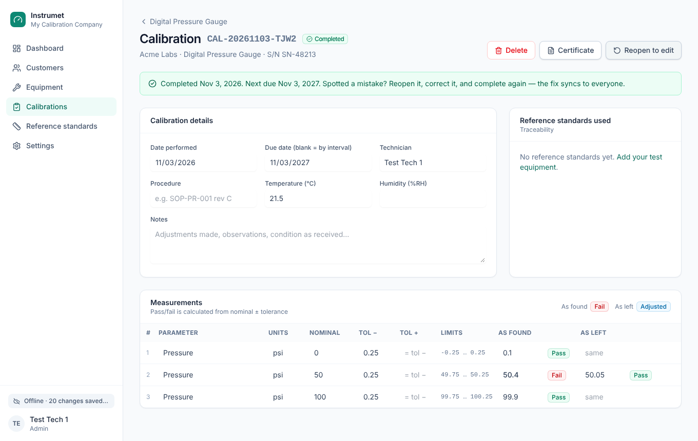

# Instrumet Calibration

Offline-first desktop app for calibration technicians. Add customers, their
equipment, reference standards and calibration results with or without an
internet connection. Everything is saved on the laptop first and syncs
automatically. When one technician fixes a mistake, every other technician sees
the change within seconds.

**Stack:** Electron · React · Tailwind · [PowerSync](https://powersync.com)
(local SQLite + sync) · [Supabase](https://supabase.com) (Postgres, Auth)



## How sync works

```
 Laptop (Electron window)                         Cloud
 ┌──────────────────────────────┐   download   ┌──────────────────┐   logical    ┌──────────────┐
 │ React UI ── live queries ──► │ ◄─────────── │ PowerSync Service│ ◄─────────── │   Supabase   │
 │ local SQLite (OPFS)          │  (streaming) │  (Development)   │  replication │   Postgres   │
 │ upload queue ─ uploadData() ─┼──────────────┼──────────────────┼────────────► │ (RLS-guarded)│
 └──────────────────────────────┘   writes via supabase-js (REST)               └──────────────┘
```

* Reads always come from local SQLite, so the app is instant and works offline.
* Writes go to local SQLite and an upload queue. When online, the queue uploads
  to Supabase. Edits upload only the changed fields, so two technicians editing
  different fields of the same record don't clobber each other.
* Supabase row-level security limits each technician to their own company's data.
* If the server permanently rejects a change (for example, the record was deleted
  by someone else), it is skipped so the queue never jams, and shown under
  **Settings → Changes the server rejected**.

## Running it

```bash
npm install
cp .env.example .env     # fill SUPABASE_URL, SUPABASE_ANON_KEY, POWERSYNC_URL
npm run dev              # development
npm run dist:win         # Windows installer  (also dist:mac, dist:linux)
```

**Windows (PowerShell 5.1):** create `.env` with ASCII encoding or the first key is
not read, e.g. `@"…"@ | Set-Content -Path .env -Encoding ascii`.

**`Error: Electron uninstall`** on `npm run dev` means Electron's binary download was
skipped during install. Run `node node_modules/electron/install.js`, then retry.

Only `SUPABASE_URL`, `SUPABASE_ANON_KEY` (publishable key) and `POWERSYNC_URL`
are built into the app. The admin tokens in `.env` are for the CLI only and are
never bundled.

## Accounts & signing in

* **The first account created becomes the company admin.** Everyone after that
  creates an account in the app and sees *Waiting for approval* until an admin
  clicks **Approve** in **Settings → Team**. Their screen unlocks by itself.
  Pending accounts receive no company data, so sign-ups can stay open.
* **You can't get locked out of your own work.** Signing out keeps your data on
  the computer, and you can sign back in **without internet**. The password is
  checked against a salted PBKDF2 fingerprint saved at your last online sign-in;
  the password itself is never stored. Syncing resumes automatically once the
  connection is back.
* Sessions never expire on their own (Supabase session time-box and inactivity
  timeout are off), so technicians stay signed in through long offline stretches.
* Only a *different* person signing in on a computer replaces the local data, and
  the sign-in screen warns first if that would lose unsynced changes. To hand a
  computer to someone else, reset Windows (laptops use BitLocker for data at rest).
* **Forgot password:** an admin opens **Settings → Team → Reset password**, gets a
  temporary password to give the technician, and the technician changes it under
  **Settings → Your profile → Change password**. No email links involved.
* **Someone leaves:** **Settings → Team → Remove**. They lose access immediately and
  the company data is removed from their laptop the next time it connects. Their past
  calibrations are kept. A company can never remove or demote its last admin.
* Changes are never dropped because of a sign-in problem: uploads wait for a valid
  session and only genuinely invalid changes go to *Settings → Changes the server rejected*.

## Installing on laptops & updates

Install with the **Instrumet-Calibration-Setup-x.y.z.exe** from the repo's
[Releases page](https://github.com/dathomaster/instrumet-cal-databse/releases).
The installer isn't code-signed yet, so the first time Windows SmartScreen says
"unknown publisher": click **More info → Run anyway**.

Installed apps **update themselves**. They check for a new release at launch and
every 4 hours, download it in the background, and show "Restart to update". If
nobody clicks it, the update installs the next time the app is closed. Local data and
unsynced changes are kept across updates.

**Publishing an update** (GitHub builds the installer; nothing to build locally):

```bash
npm version 0.3.0 --no-git-tag-version   # bump the version
git commit -am "Release 0.3.0"
git tag v0.3.0
git push origin main v0.3.0
```

The tag triggers `.github/workflows/release.yml`, which builds the Windows installer
and publishes the release (about 5 to 10 minutes). Updates are served from this
repo's public Releases; if the repo is made private, the update host must change.

## Project layout

| Path | What |
|---|---|
| `supabase/migrations/` | Database schema, RLS, triggers, PowerSync publication |
| `supabase/powersync_role.sql` | Dedicated replication login for PowerSync (password lives in `.env`) |
| `powersync/` | PowerSync Cloud config (`service.yaml`, `sync-config.yaml`), deployed with the PowerSync CLI |
| `src/main/` | Electron main process (secure `app://` scheme, CSP, Save-as-PDF) |
| `src/renderer/src/powersync/` | Client schema, database, Supabase connector (`uploadData`, `fetchCredentials`) |
| `src/renderer/src/pages/` | Screens |
| `tests/e2e-sync.cjs` | Two-laptop end-to-end sync test (online, offline, reconnect, live edits) |
| `tests/e2e-auth.cjs` | Approval flow, offline sign-out/sign-in, restart offline, auto-resume |
| `tests/e2e-admin.cjs` | Admin password reset, change password, remove a technician |
| `.github/workflows/release.yml` | Builds + publishes the Windows installer when a `v*` tag is pushed |

## Changing the schema

1. Add a migration in `supabase/migrations/`, apply it, and add any new table to the
   `powersync` publication.
2. Add the table to `powersync/sync-config.yaml` and run `npx powersync deploy sync-config`.
3. Regenerate the client schema: `npx powersync generate schema --output=ts --output-path=src/renderer/src/powersync/AppSchema.ts`
   (on Node 22, run the CLI with `node --js-explicit-resource-management`).
